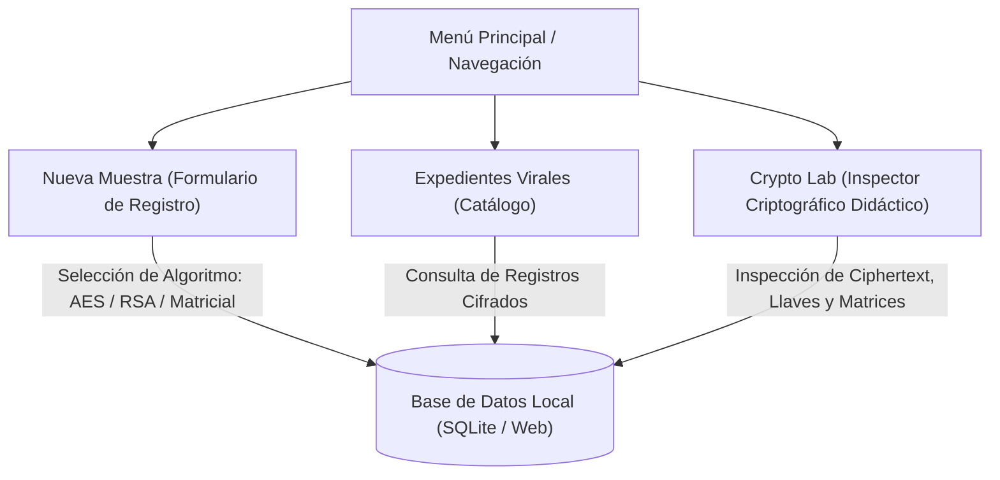

# Plan de Proyecto: App_Virologia (Sistema de Expedientes de Laboratorio)

## 1. Resumen Ejecutivo y Alcance
- **Propósito**: Práctica académica de parcial para implementar y demostrar algoritmos criptográficos en un entorno híbrido móvil y web.
- **Dominio**: Gestión y protección de expedientes de muestras virales, pacientes y diagnósticos clínicos confidenciales.
- **Entorno de producción**: No aplica. Es una entrega escolar autocontenida y didáctica.

---

## 2. Pila Tecnológica (Stack)
- **Lenguaje**: Kotlin (100% de la lógica y la interfaz).
- **Framework de UI**: Compose Multiplatform (Jetpack Compose para Android y WebAssembly `wasmJs`).
- **Plataformas Objetivo**:
  1. **Móvil (Android)**: Ejecutable y desplegable en dispositivo físico mediante Android Studio y ADB.
  2. **Web (Wasm/JS)**: Ejecutable en navegador web mediante servidor de desarrollo local Gradle (`./gradlew wasmJsBrowserDevelopmentRun`).
- **Base de Datos**: Capa de persistencia local adaptativa (SQLite en Android / almacenamiento persistente web en navegador), unificada a través de un patrón Repository en Kotlin común (`commonMain`).

---

## 3. Arquitectura Criptográfica

| Tipo | Algoritmo | Propósito en la Aplicación |
| :--- | :--- | :--- |
| **Estándar 1** | **AES (Advanced Encryption Standard)** | Cifrado simétrico de alta velocidad para el cuerpo del diagnóstico clínico y observaciones de la muestra. |
| **Estándar 2** | **RSA (Rivest-Shamir-Adleman)** | Cifrado asimétrico con par de llaves (pública/privada) para sellado y firma de autorización del laboratorista/epidemiólogo. |
| **Inventado** | **Cifrado Matricial Modular Dinámico (Álgebra Lineal)** | Cifrado por bloques vectoriales utilizando matrices clave invertibles en el anillo modular $\mathbb{Z}_{256}$. Incluye demostración explícita de determinante $\det(K)$, coprimalidad $\gcd(\det(K), 256) = 1$, cálculo de matriz adjunta e inversa modular $K^{-1}$, con rotación dinámica de vectores para evitar criptoanálisis de frecuencia. |

---

## 4. Módulos y Pantallas de la Interfaz

1. **Catálogo de Muestras / Expedientes**:
   - Listado de registros: Código de muestra, Patógeno (ej. SARS-CoV-2, Ébola, Influenza H1N1, Dengue), Nivel de Bioseguridad (BSL-1 a BSL-4), y estado de cifrado.
2. **Formulario de Registro de Muestra**:
   - Captura de paciente, carga viral, sintomatología y diagnóstico confidencial.
   - Selector interactivo del algoritmo de cifrado antes de guardar en la base de datos.
3. **Crypto Lab (Inspector Criptográfico)**:
   - Visualización del texto en crudo almacenado en la base de datos (Hexadecimal / Base64).
   - Para el algoritmo de **Álgebra Lineal**: visualización interactiva de la matriz $K$, el determinante, la matriz inversa $K^{-1}$ y la multiplicación matricial paso a paso.
   - Botón de descifrado en tiempo real con verificación de integridad.

---

## 5. Próximos Pasos de Implementación
1. Configurar la estructura del proyecto Gradle con Kotlin Multiplatform (`composeApp` con `commonMain`, `androidMain`, `wasmJsMain`).
2. Implementar los motores criptográficos puros en `commonMain`:
   - Módulo AES.
   - Módulo RSA.
   - Módulo de Álgebra Lineal (Cifrado Matricial Modular).
3. Diseñar la capa de datos (Entidad de Virología + Base de datos local).
4. Construir las pantallas en Compose Multiplatform y validar ejecución en Web y Android.
